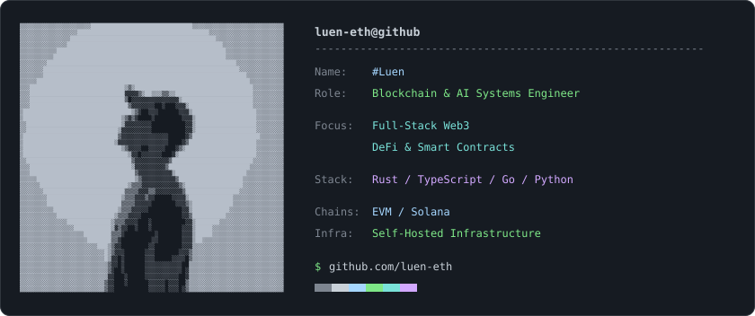

<a href="https://github.com/luen-eth">
  <picture>
    <source media="(prefers-color-scheme: dark)" srcset="https://raw.githubusercontent.com/luen-eth/luen-eth/main/assets/profile-dark.svg">
    <source media="(prefers-color-scheme: light)" srcset="https://raw.githubusercontent.com/luen-eth/luen-eth/main/assets/profile-light.svg">
    
  </picture>
</a>
